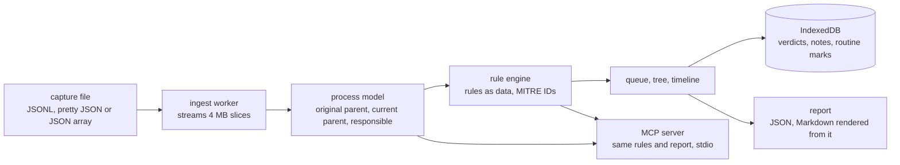

# Architecture

Ficus is passive and offline. It reads a capture file that `eslogger` (or Mac Monitor) already wrote; it never attaches to Endpoint Security, runs a command or opens a network connection. The page is built into one self-contained `dist/index.html`, and [`vite.config.ts`](../vite.config.ts) puts a Content-Security-Policy of `connect-src 'none'` inside it.

| Folder | What it holds |
|---|---|
| [`src/ingest`](../src/ingest) | Reads a dropped file in a worker, line by line or object by object, keeps only the fields the model needs, and takes the capture's fingerprint from its head. |
| [`src/model`](../src/model) | Builds processes from the events and the relations between them: the three kinds of parent, exec chains, file events, launch items. |
| [`src/rules`](../src/rules) | The rules, the engine that runs them, the known-indicator list and the MITRE mapping. See [Rules](rules.md) and [What the queue means](triage-queue.md). |
| [`src/session`](../src/session) | Sessions in IndexedDB, saved session files, the save folder, routine marks and the in-memory cap on loaded captures. See [Running Ficus, sessions and storage](sessions-and-storage.md). |
| [`src/report`](../src/report) | The report for security: a JSON document and the Markdown rendered from it. |
| [`src/ui`](../src/ui) | The React page: Triage, Tree, Timeline, the detail pane and the Suspicious tab. See [Using Ficus](using-ficus.md). |
| [`src/mcp`](../src/mcp) | The stdio MCP server, built separately into `dist-mcp/`. It reuses the model, rules and report. See [MCP](mcp.md). |

The cleaner (`scripts/ficus-clean.sh` and `ficus-clean.jq`) is separate from the page: it runs on the Mac being investigated, before a capture is loaded anywhere. See [Cleaning a capture](cleaning-captures.md).

Load times and memory use are in [Performance](performance.md).
